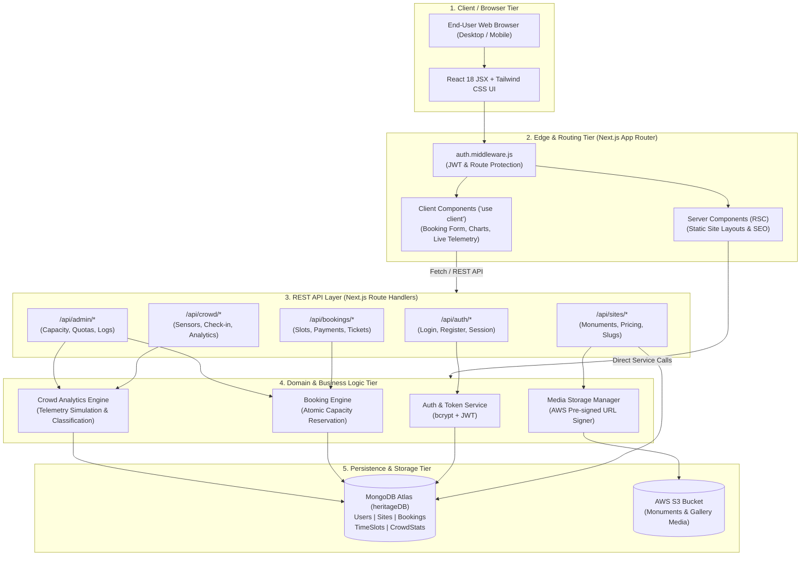
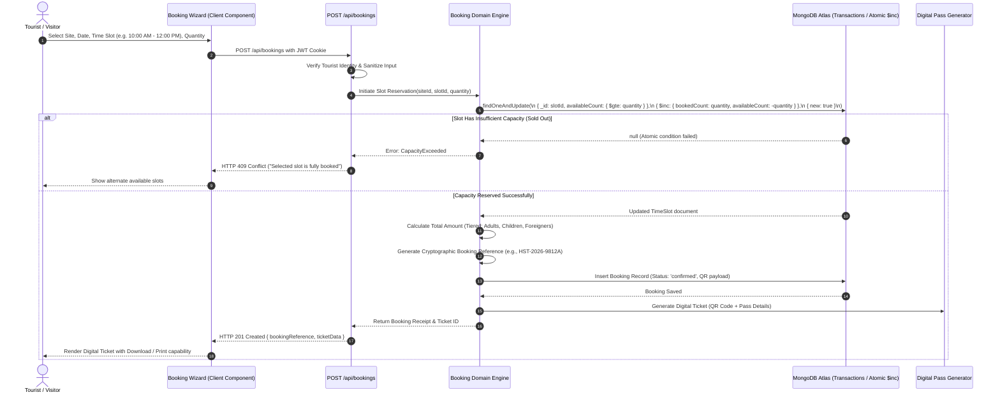
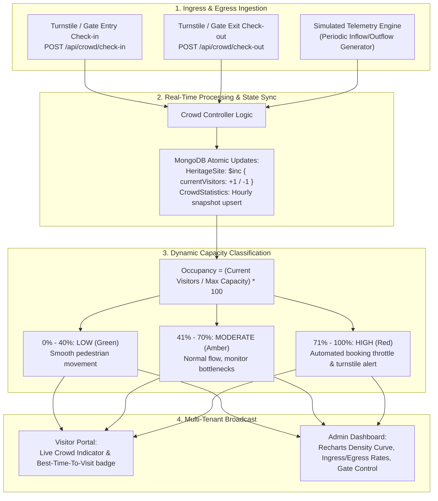
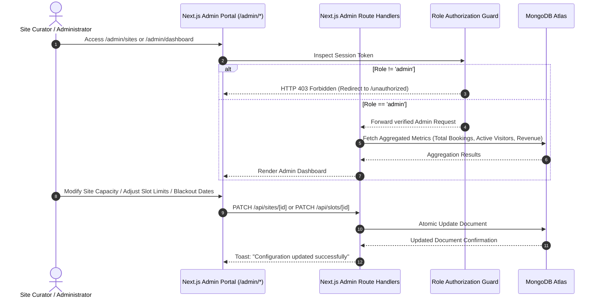
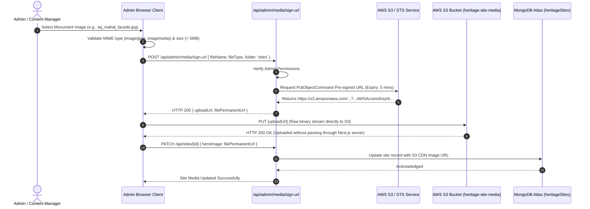
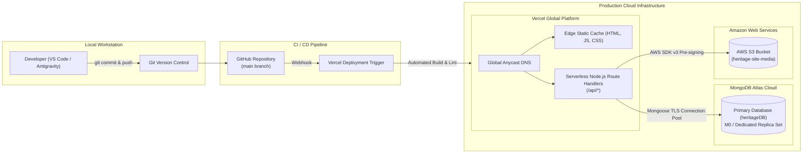

# System Architecture Specification
## Heritage Site Crowd Management System

---

### Document Overview
- **Project Title:** Heritage Site Crowd Management System
- **Classification:** College Continuous Assessment (CA) Project / Production-Oriented System Architecture
- **Lead Role:** Senior Software Architect, Full-Stack Engineer, Database Architect & Technical Project Lead
- **Target Platform:** Web (Desktop, Tablet, Mobile Responsive)
- **Primary Tech Stack:** Next.js (App Router, JavaScript ES6+), React.js, Tailwind CSS, MongoDB Atlas (Mongoose ODM), AWS S3, Vercel

---

## 1. Executive Summary & System Objectives

The **Heritage Site Crowd Management System** is a smart-tourism and crowd analytics platform engineered for prominent national monuments, cultural heritage sites, and historical destinations (e.g., Taj Mahal, Red Fort, Qutub Minar, Victoria Memorial, Ajanta & Ellora Caves). 

The platform addresses two complementary operational challenges:
1. **Visitor Experience (Public/Tourist Facing):** Empowers tourists to discover historical context, inspect high-resolution galleries, understand visiting rules, assess expected crowd density in advance, reserve time-slotted digital entry passes, and receive real-time entry alerts.
2. **Administrative Capacity & Safety Governance (Admin Facing):** Provides site curators, heritage officers, and ticket controllers with automated crowd telemetry, live-style turnstile ingress/egress accounting, dynamic quota management, historical crowd density analytics, and instant anomaly alerts to prevent hazardous overcrowding and wear-and-tear on fragile monument infrastructure.

> [!NOTE]
> **Data Disclosure Standard:** In accordance with architectural integrity requirements, all real-time crowd metrics are generated via a high-fidelity algorithmic simulation engine (mimicking turnstile sensors and ticketing gate counters) unless specifically bridged to physical IoT turnstile hardware or official governmental ASI/ministry APIs.

---

## 2. Layered Architecture Breakdown

The system is structured into seven distinct architectural layers adhering to the **Separation of Concerns (SoC)** principle:

```
+-----------------------------------------------------------------------------------+
|                           1. PRESENTATION LAYER                                   |
|  Tailwind CSS v3 | Heritage Palette (Ivory/Sandstone/Forest Green/Antique Gold)  |
|  Lucide React Icons | Recharts Interactive Canvas | Fully Responsive Breakpoints |
+-----------------------------------------------------------------------------------+
                                         │
                                         ▼
+-----------------------------------------------------------------------------------+
|                        2. FRONTEND APPLICATION LAYER                              |
|  Next.js App Router | React Server Components (RSC) & Client Components ('use client') |
|  React 18 Hooks (useState, useEffect, useContext) | Custom Hooks | Auth Context   |
+-----------------------------------------------------------------------------------+
                                         │
                                         ▼
+-----------------------------------------------------------------------------------+
|                           3. BACKEND / API LAYER                                  |
|  Next.js Route Handlers (/api/*) | Node.js Runtime | RESTful Endpoint Specifications |
|  JWT & Cookie-Based Middleware | Request Validation & Input Sanitization Layer     |
+-----------------------------------------------------------------------------------+
                                         │
                                         ▼
+-----------------------------------------------------------------------------------+
|                        4. BUSINESS LOGIC & DOMAIN LAYER                           |
|  Atomic Booking Engine | Anti-Overbooking Concurrency Lock | Ticket Fee Calculator|
|  Crowd Density Classification (Low/Mod/High) | Algorithmic Telemetry Simulator     |
+-----------------------------------------------------------------------------------+
                         │                                         │
                         ▼                                         ▼
+------------------------------------+   +------------------------------------------+
|         5. DATABASE LAYER          |   |          6. CLOUD STORAGE LAYER          |
|  MongoDB Atlas Cluster (heritageDB)|   |  AWS S3 Bucket: `heritage-site-media`    |
|  Mongoose ODM Schema Models        |   |  Pre-signed Upload URLs | Direct Ingress |
|  Atomic Updates ($inc, $set)       |   |  Public CDN Distribution for Web Assets  |
+------------------------------------+   +------------------------------------------+
                                         │
                                         ▼
+-----------------------------------------------------------------------------------+
|                    7. DEPLOYMENT & INFRASTRUCTURE LAYER                           |
|  Vercel Edge Network & Serverless Lambda Functions | Environment Isolation         |
|  MongoDB Atlas Managed VPC | AWS IAM Least-Privilege Role Security                |
+-----------------------------------------------------------------------------------+
```

### 2.1 Layer Responsibilities & Protocols

#### 1. Presentation Layer
- **Components:** Built using Tailwind CSS, adhering to an Indian Heritage aesthetic: Ivory (`#FDFBF7`), Sandstone (`#D4A373`), Forest Green (`#1B4332`), Antique Gold (`#C5A059`), and Charcoal (`#212529`).
- **Icons & Graphics:** Lucide React icons for intuitive wayfinding; Recharts for SVG-rendered real-time crowd gauges, hourly capacity area charts, and visitor demographic bars.
- **Protocol:** Semantic HTML5 compiled through JSX; client-side browser DOM rendering.

#### 2. Frontend Application Layer
- **Server Components:** Default execution mode in Next.js App Router. Renders static heritage descriptions, architectural histories, and initial SEO payloads on the server without shipping JavaScript bundles to the browser.
- **Client Components (`'use client'`):** Reserved for dynamic forms, booking date/time slot selectors, real-time telemetry polling, modal windows, and interactive analytics charts.
- **State Management:** React `useState`, `useReducer`, and Context API (`AuthContext`, `CrowdContext`) avoid third-party state bloat (e.g., Redux) while sustaining reactivity.

#### 3. Backend / API Layer
- **Route Handlers:** Pure Node.js execution through Next.js `app/api/**/route.js`. Handles standard HTTP verbs (`GET`, `POST`, `PATCH`, `DELETE`).
- **Gateways & Middleware:** Edge/Node.js middleware inspects HTTP-only session cookies, validates JWT authenticity, extracts `user.role`, and routes unauthorized traffic away from protected visitor or admin enclaves.

#### 4. Business Logic & Domain Layer
- **Atomic Booking Pipeline:** Handles booking transactions by checking slot thresholds and incrementing `bookedCount` within atomic MongoDB transactions (`findOneAndUpdate` with `$inc` and `$expr`), guaranteeing zero double-booking under concurrency.
- **Crowd Classification Algorithm:** Dynamically maps instantaneous visitor counts against monument maximum carrying capacities:
  $$\text{Occupancy Percentage} = \left(\frac{\text{Current Active Visitors}}{\text{Maximum Carrying Capacity}}\right) \times 100$$
  - `0% - 40%`: **Low Density** (Optimal for photography, relaxed exploration).
  - `41% - 70%`: **Moderate Density** (Standard flow, minimal queuing).
  - `71% - 100%`: **High Density** (Approaching safety limits; warning banners triggered).
- **Telemetry Ingestion & Simulation Engine:** Generates realistic pedestrian distributions (arrival surges at 10:00 AM and 03:00 PM; tapering near closing hours).

#### 5. Database Layer
- **Engine:** MongoDB Atlas (`heritageDB`).
- **ODM:** Mongoose with connection pooling and cached singleton connection instances across serverless executions.
- **Data Integrity:** Schema-enforced validation, unique compound indexing (preventing identical time slots per monument per day), and cascading updates.

#### 6. Cloud Storage Layer
- **Provider:** Amazon Web Services (AWS) Simple Storage Service (S3).
- **Architecture:** Client-side pre-signed URL retrieval. Images flow directly from client browser to S3 via temporary cryptographically signed AWS STS tokens, offloading large binary transfers from Next.js serverless functions.

#### 7. Deployment Infrastructure Layer
- **Provider:** Vercel (Global Edge Network + Serverless Node.js compute).
- **Integration:** Automated GitHub webhook deployments, environment variable scoping (`production`, `preview`, `development`), and health probe verification.

---

## 3. Next.js vs. React.js: Technical Distinction & Architectural Roles

A common misconception in academic projects is treating React and Next.js as competing or detached libraries. In our architecture:

> **Fundamental Principle:** Next.js is not a replacement for React; **Next.js is a full-stack meta-framework built on top of React**. React acts as the *component view engine*, while Next.js acts as the *application container, compiler, and server architecture*.

| Architectural Concern | React.js Responsibility | Next.js App Router Responsibility |
| :--- | :--- | :--- |
| **Component Model** | Functional UI components, JSX syntax, Props passing, component lifecycle. | Distinguishes between Server Components (RSC) and Client Components (`'use client'`). |
| **State & Interactivity** | `useState`, `useEffect`, `useContext`, local component state. | Manages route-level cache, server cache revalidation (`revalidatePath`, `revalidateTag`). |
| **Routing** | Historically requires client-side libraries (e.g., `react-router-dom`). | **File-system based App Router** with route groups `(public)`, `(admin)`, dynamic segments `[slug]`, `[id]`. |
| **Rendering Strategy** | Client-Side Rendering (CSR) via DOM hydration. | **Hybrid Rendering:** Server-Side Rendering (SSR), Static Site Generation (SSG), and streaming with Suspense. |
| **Backend & APIs** | None (purely client-side UI library). | **Full-Stack Route Handlers (`route.js`)** providing native REST API micro-endpoints running in Node.js. |
| **Data Fetching** | Fetch inside `useEffect` or React Query on the client. | Direct asynchronous `async/await` data fetching directly inside Server Components before HTML generation. |
| **SEO & Document Head** | Requires external libraries (e.g., React Helmet). | Native declarative `generateMetadata()` API rendering server-baked OpenGraph and meta tags. |
| **Asset Optimization** | Standard `` elements without automatic resizing. | `<Image />` component with automatic WebP conversion, lazy loading, and responsive sizing. |

---

## 4. End-to-End System Workflow Diagrams (Mermaid)

### Diagram 1: Complete Layered Architecture



---

### Diagram 2: User Registration & Authentication Workflow

```mermaid
sequenceDiagram
    autonumber
    actor User as Visitor / Admin
    participant UI as React Client Component (LoginForm / RegisterForm)
    participant API as /api/auth/[register|login]
    participant BCrypt as Password Engine (bcryptjs)
    participant DB as MongoDB Atlas (Users Collection)
    participant JWT as Token Manager (jose / jsonwebtoken)

    User->>UI: Input Credentials (Email, Password, Name)
    UI->>API: POST /api/auth/register or /api/auth/login
    API->>API: Validate input schema (Regex, Required fields)
    
    alt Registration Flow
        API->>DB: Check if user exists (email lookup)
        DB-->>API: User status
        API->>BCrypt: Hash plaintext password (12 salt rounds)
        BCrypt-->>API: Return passwordHash
        API->>DB: Insert new User (Role: 'visitor')
        DB-->>API: Document created
    else Login Flow
        API->>DB: Find user by email
        DB-->>API: Return user document with passwordHash
        API->>BCrypt: Compare plaintext password with hash
        BCrypt-->>API: Comparison boolean result
    end

    API->>JWT: Generate JWT Payload { id, email, role } (Expiry: 24h)
    JWT-->>API: Signed JWT String
    API-->>UI: Set-Cookie: token=JWT; HttpOnly; Secure; SameSite=Lax; Path=/
    UI-->>User: Redirect to /dashboard or /explore (Updated AuthState)
```

---

### Diagram 3: High-Concurrency Ticket Booking Workflow



---

### Diagram 4: Crowd Monitoring & Live Turnstile Telemetry



---

### Diagram 5: Administrator Site & Capacity Governance Workflow



---

### Diagram 6: AWS S3 Media Asset Direct Upload Architecture



---

### Diagram 7: Application Deployment & Hosting Architecture



---

## 5. Architectural Quality Attributes & Non-Functional Requirements (NFR)

1. **Scalability:** By leveraging Next.js Server Components, over 80% of public page requests (historical overview, site descriptions) are rendered statically or cached at the Edge, shielding the MongoDB database from high-volume tourist read traffic.
2. **Availability:** Database is provisioned via MongoDB Atlas multi-zone replica sets, guaranteeing 99.95% uptime and automated failover.
3. **Data Consistency:** All ticketing and slot-booking operations employ atomic conditionals (`$gte`, `$inc`), precluding overselling without necessitating heavy, locking database table locks.
4. **Security & Compliance:** Strict zero-trust posture: passwords hashed via bcrypt (12 rounds), tokens signed via HMAC-SHA256 in HTTP-only cookies, and all cloud media uploads gated via signed tokens.
5. **Transparency:** Crowd metrics render with prominent indicators distinguishing actual physical gate telemetry from algorithmic mathematical projections.
